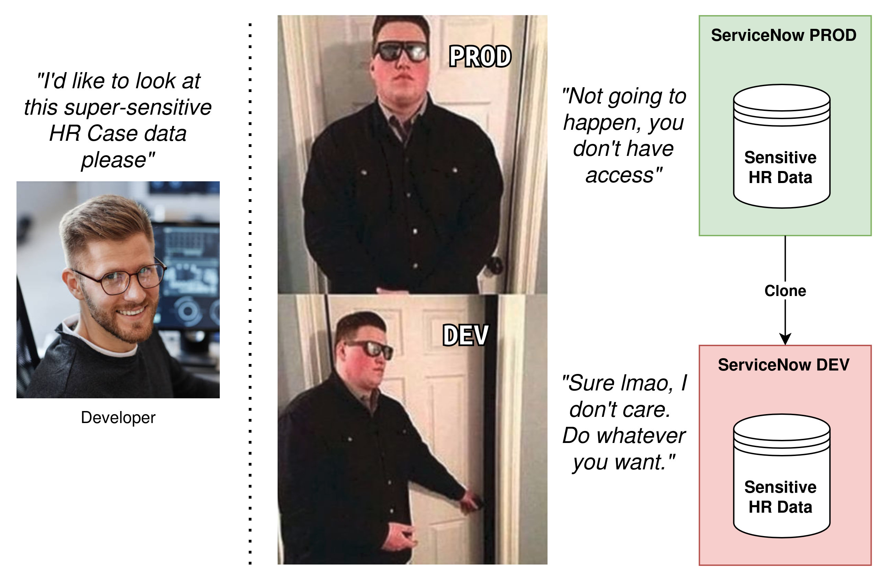
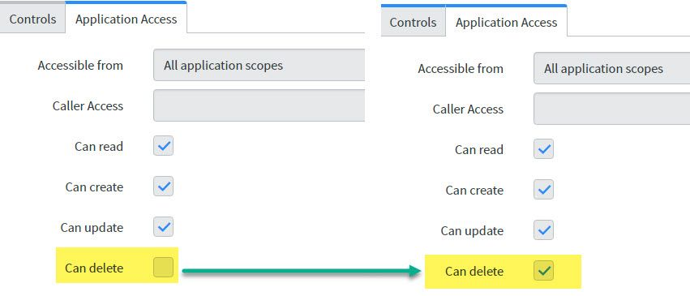

## The challenge 
ServiceNow is a secure platform, with a fairly robust security model. 
Consider HR Cases. Typically, the only people who can see this data is HR case workers and the related user themselves, and is not available to anyone else. 

However, most companies are very relaxed about security and access to non-production environments, such as DEV and TEST. 
* The 'admin' role is given out to any developers, including external contractors, allowing them to do almost anything. 
* The 'impersonator' role is given out to testers to fast-track their testing, allowing them to impersonate almost any other user. 

A ServiceNow **clone** typically includes almost everything, including any sensitive data. While this sensitive data may be tightly secured in **production**, it can be vulnerable after being cloned down to non-prod instances. 
These are considered **data leaks** and should be mitigated.

[](meme-dev-doesnt-care.jpg)

The solution is to remove the sensitive data in your non-prod instances of ServiceNow, either by masking it or by removing it entirely.

## The top culprits
Let's have a think of the most likely data in ServiceNow that you would want to protect, and wouldn't want leaked. 
* **HR Case Data.** HR cases are typically very sensitive, and would be a severe problem if leaked.
* **Sensitive Requests.** It's fairly common to see customers using Catalog Requests (RITMs) to service sentitive or confidential requests. Usually, they will protect them using a custom security model (e.g. custom ACLs).
* **Tracked Files in the CMDB.** These files are typically configuration files for running services, and are likely to contain usernames and passwords. 
* **User data [sys_user]**. In most cases, user data is not all that sensitive. However, it's possible that the scope of user data can grow to contain PII (personally identifiable data), and should be cleansed during a clone. E.g. home address, work history, pay rate. 
* **Knowledge [kb_knowledge].** I've seen some customers use Knowledge Articles which contain configuration details for sensitive infrastructure systems, which are secured in their PROD instance, but visible to any developer in DEV. E.g. break-glass instructions for regaining access to a system if the admin password is forgotten. 

You should also consider related data.
* Related records (e.g. incidents & incident tasks). 
* Attachments on the record (sys_attachment). 
* Emails relating to the record (sys_email) 
* Journal entries on the record (comments, work notes, etc). 
* History of the record (sys_audit, sys_history, etc). 
* SLA records on tasks (task_sla). 
* Deletion history (sys_audit_delete). 
* New calls and Interactions related to tasks. 

## Data Integrations
You should also consider data feed integrations in non-production instances. Review what integrations are feeding data into ServiceNow, and assess whether it's secure & safe for admin users to see.

There's no point in cleansing sensitive user data, if an automated data feed is going to bring it all back in again.

**Recommendation 1**: Each instance should have it's own credentials & service account for each integration, don't share 1 set of credentials across each SN instance. That way, the data that it uses can be limited, and non-production instances of ServiceNow shouldn't be pulling down from production data sources.

**Recommendation 2**: Are you non-production instances using Discovery on production networks? Assess if you are comfortable with non-production instances of ServiceNow potentially containing configuration details for production systems.

## Delete vs Mask 
There's an argument between: 
* Deleting the record entirely 
* Keep the record, mask the data 
 
Masking the data involves not deleting the record, but masking or obfuscating the data, either: 
* just specific data (e.g. mask anything that looks like a credit card in the "Description" field). 
* entire fields (either clear it, or replace with a placeholder). 
 
Keeping the record but masking the data allows for reporting building & limited testing in lower environments with all of the existing records, but prevents any data leaking due to the data being masked. Whereas deleting the data results in empty tables, which may hinder the diagnosis of any issues in lower environments. 

## Test your clone profile regularly!
To ensure that sensitive data isn't leaking down into your non-prod instances, I recommend regularly cloning using your clone profile, then reviewing & assessing the data that comes down in a clone.

Early identification leads to early prevention!

## Using Clone Exclude Table rules 
At first glance, **Clone Exclude Table** rules for clones appears to be a perfect answer. However, they are not a good solution, and should not be used for cleansing data during a clone. 
 
A Clone Exclude Table rule instructs an entire table to be dropped on the target instance after it has been cloned over. This drops all data, both from the source instance and any previously existing data from the target (unless **preserved** by a **Clone Preserve Data** rule). 
 
However, this approach is blunt. It drops the record, but does not clean-up any additional related data, including: 
* attachments 
* emails 
* comments & work notes 
 
## Using a post-clone cleanup script 
The best solution I've found so far for post-clone data cleansing is just to script it. 
 
> Note: there used to be a row limit on GlideRecord of 10,000, and you'd only be able to delete 10,000 records with a single query. This doesn't appear to be the case anymore and there's not a limit on a GlideQuery, but test your solution to be sure. 
 
It doesn't need to be fancy: 
* Use `GlideRecord` and `.deleteRecord()` to delete records. Using GlideRecord should trigger any cascade rules and clean-up a lot of the related data. 
* This will run headless. Include logging to so you can see what's happening, and info if it fails. 
* Write your script to use System Properties [sys_properties] to configure your script, instead of hard-coding everything. Mark those sys_properties as "Preserve" if you want to them to survive the clone and be specific to that instance. 
 
What you'll want to do is: 
1. Create a new Clone Cleanup Script [clone_cleanup_script] in PROD (or create in DEV and promote through to PROD). 
2. Give it a name e.g. "Post-clone data cleanse - HR Case" 
3. Ensure "Active" is checked. 
4. Give it a script. 
 
Next time your instance is cloned down over another instance, that script will run and perform the data cleansing. 

### HR Tables and Cross-Scope Access
Remember to create your post-clone scripts in the same scope as the table that you will clean!

Otherwise, your post-clone script will run from the "Global" scope, which doesn't have "Delete" access to HR tables by default, and no data will be deleted.

The **not recommended** alternative is to update the "Application access" settings on the HR tables you want to clean, and ensure that "Can delete" is ticked. However, this could be a security risk, so maybe don't do that.

[](application-access-can-delete.jpg)

**Remember:** Deleting a record will delete:
* Comments & work notes
* Task SLAs
* Attachments
It will **not** delete:
* History (sys_audit)
* Related tasks
* Interactions
* Emails
* Deleted Record entries including a snapshot of the record
* Flow contexts

### Delete 
Here's an example post-clone cleanup script to bulk-delete HR Cases after a clone.
 
```js 
var grHRC = new GlideRecord("sn_hr_core_case");
grHRC.query(); // Get them all
while (grHRC.next()) {
    var sys_id = ""+grHRC.sys_id;
    var tableName = grHRC.getRecordClassName()
    grHRC.deleteRecord();

    // Delete emails
    var grE = new GlideRecord("sys_email");
    grE.addQuery("target_name", tableName);
    grE.addQuery("instance", sys_id);
    grE.addNotNullQuery("instance");
    grE.query();
    while (grE.next()) {
        grE.deleteRecord();
    }

    // Delete the Deleted Record snapshot, if present
    var grDel = new GlideRecord("sys_audit_delete");
    grDel.addQuery("tablename", tablename);
    grDel.addQuery("documentkey", sys_id);
    grDel.query();
    if (grDel.next()) { // Notice we used "if" there, as there should only ever be 1
        grDel.deleteRecord();
    }
}
``` 
 
### Obfuscate 
I haven't come across a recommended script or solution for obfuscating data in a post-clone script.

It would depend on **how** you'd like to obfuscate data.
* Do you just clear the data? Then simply set those fields to "(empty)" or "(redacted)".
 E.g. Clear the 'Mobile phone' field for all users.
* Do you want to replace the data with placeholder data? Replace what's in the fields with automatically generated placeholders. (e.g. random numbers).
 E.g. Replace the "Short description" and all notes for all HR cases with lorem ipsum. Here's an example Codepen with a lorem ipsum generator without any dependancies. https://codepen.io/codewithfaraz/pen/OJaVNWG

```js
function generateLoremText(numParagraphs, numWords) {
  var loremText = '';
  var words = [
    'Lorem',
    'ipsum',
    'dolor',
    'sit',
    'amet',
    'consectetur',
    'adipiscing',
    'elit',
    'sed',
    'do',
    'eiusmod',
    'tempor',
    'incididunt',
    'ut',
    'labore',
    'et',
    'dolore',
    'magna',
    'aliqua',
    'Ut',
    'enim',
    'ad',
    'minim',
    'veniam',
    'quis',
    'nostrud',
    'exercitation',
    'ullamco',
    'laboris',
    'nisi',
    'ut',
    'aliquip',
    'ex',
    'ea',
    'commodo',
    'consequat',
    'Duis',
    'aute',
    'irure',
    'dolor',
    'in',
    'reprehenderit',
    'in',
    'voluptate',
    'velit',
    'esse',
    'cillum',
    'dolore',
    'eu',
    'fugiat',
    'nulla',
    'pariatur',
    'Excepteur',
    'sint',
    'occaecat',
    'cupidatat',
    'non',
    'proident',
    'sunt',
    'in',
    'culpa',
    'qui',
    'officia',
    'deserunt',
    'mollit',
    'anim',
    'id',
    'est',
    'laborum',
  ];

  for (var i = 0; i < numParagraphs; i++) {
    var paragraph = '';
    for (var j = 0; j < numWords; j++) {
      var randomWord = words[Math.floor(Math.random() * words.length)];
      paragraph += randomWord + ' ';
    }
    loremText += '<p>' + paragraph + '</p>';
  }
  return loremText;
}
```
 
## Using the Data Privacy plugin 
Looks like ServiceNow has brought out a plugin for just this purpose called "Data Privacy". 
 
In a nutshell, it involves some post-clone cleanup scripts that trigger data privacy jobs that work to obscure and anonymize data according to data privacy rules that you would've already configured. 
 
I haven't played around with it yet, but it sounds promising. 
 
https://docs.servicenow.com/bundle/tokyo-platform-security/page/administer/security/concept/dp-clone.html 
 
## Using Table Cleanup Job 
Table Cleanup Jobs are not a good solution for post-clone data cleansing. It's designed for maintenance, not ideal for one-time deletions. 
 
Table cleaner deletes older records automatically and prevent data from growing exponentially. 
 
https://docs.servicenow.com/bundle/tokyo-platform-administration/page/administer/managing-data/concept/table-cleaner.html 
 
Table cleaner is a scheduled job that runs once per hour (by default) to delete older, expired, or unwanted records from tables. Table cleaner prevents tables from growing to an unmanageable size and improves query performance. 
 
It is limited to run for 20 mins, and will stop working once it reaches that 20 mins.  
 
The clean up does not have workflow enabled, and the deletion will not trigger business rules. 
 
## Further reading 
* KB0717791 Manage and mass-delete data from a ServiceNow table 
 https://support.servicenow.com/kb?id=kb_article_view&sysparm_article=KB0717791&ct=1782459157240 
* KB015621 Clone FAQs
 https://support.servicenow.com/kb?id=kb_article_view&sysparm_article=KB0715621
* SN Community - Data Privacy and Anonymization during clone
 https://www.servicenow.com/community/developer-forum/data-privacy-and-anonymization-during-clone/m-p/3176116
* SN Community - Removing HR Case records during instance clone to sub-production instances
 https://www.servicenow.com/community/hrsd-articles/removing-hr-case-records-during-instance-clone-to-sub-production/ta-p/2314178
* SN Community - HR data to remove during cloning
 https://www.servicenow.com/community/hrsd-forum/hr-data-to-remove-during-cloning/m-p/1299877
* SN Community - Data privacy / anonymization in practice
 https://www.servicenow.com/community/developer-articles/data-privacy-anonymization-in-practice/ta-p/2574772