## The challenge
I've been using OneNote for note taking and knowledge collection for about 15 years. It ticked a lot of boxes.
* Synced across devices.
* Note taking in rich-text.
* Images & attachments.
* Robust searching abilities, even search text inside images.
* Very available, OneNote included in most Windows devices, mobile phone apps for Android and Apple.

However, I switched from Windows to Linux back in 2024 and using OneNote became more challenging as my note taking choice.
* No native Linux version, forced to use the web version.
* The web version struggles to sync images sometimes.
* The web version doesn't work without internet access.
* The web version doesn't have all of the tools & features that the desktop version has.

The tipping point was in September 2026 when OneNote for Android broke for about a week, which meant it couldn't sync any OneNote books to OneDrive anymore, forcing all OneNote books to be read-only. This effectively bricked any note taking using OneNote.

This pushed me to look for an alternative to OneNote for note taking.

https://www.reddit.com/r/OneNote/comments/1vzu321/android_onenote_app_in_offline_mode_sign_in/

[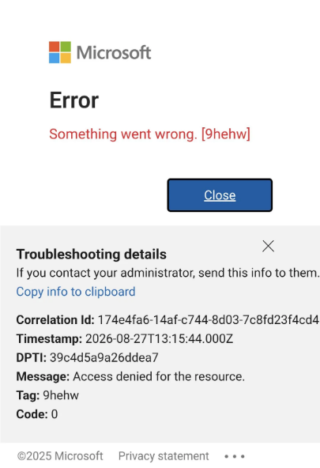](onenote-login-issue.png)

## Obsidian
An alternative I've been considering for a few years is Obsidian. A lot of people seem to talk about it, or have used it in the past.

https://obsidian.md/

[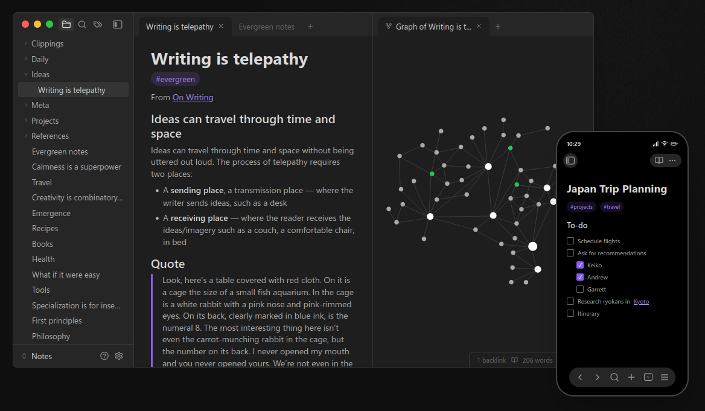](obsidian-screenshot.png.png)

> **Your thoughts are yours.**
    Obsidian stores notes privately on your device, so you can access them quickly, even offline. No one else can read them, not even us.
 **Your mind is unique.**
    With thousands of plugins and themes, you can shape Obsidian to fit your way of thinking.
 **Your knowledge should last.**
    Obsidian uses open file formats, so you’re never locked in. You own your data for the long term. 

### Similar storage structure
In OneNote, I roughly structured my notes into:
- Grouping (Section)
- Topic (the note)
Not the best structure, I'll admit, but it got the job done.

[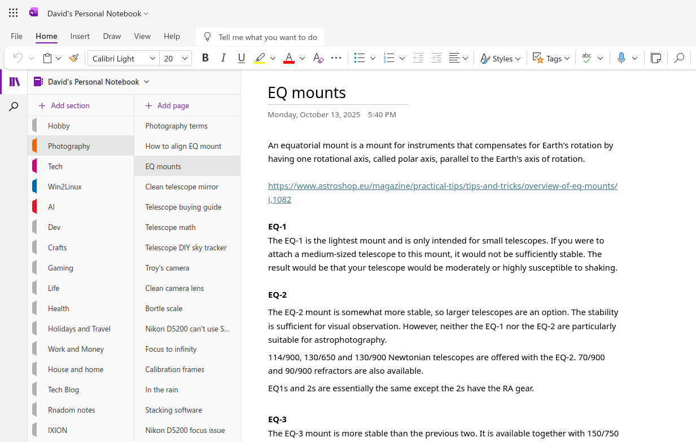](onenote-storage-structure.png)

In Obsidian, because everything is files and folders, a similar structure can be used.

[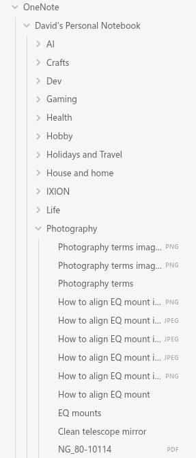](obsidian-storage-structure.png)

Heck, there's a lot of discussion from Obsidian users about which storage layout to use. Hot damn, there's a lot of different opinions! Thinking about which one to use can be quite overwhelming.

But for now, I'll stick with the storage layout that I've got. I'll look at changing once I get settled into Obsidian.

### Searching is good
OneNote's search was good as searching across all of your notes, looking for anything related. Sadly, the web version of OneNote can only search the page or the section, not across all notebooks.

[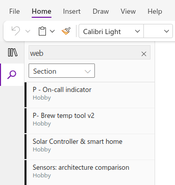](onenote-web-search-section.png)

Although the full version of OneNote can search for text in images, the web version cannot.

Obsidian is similar, you can search the entire vault for matches. 

[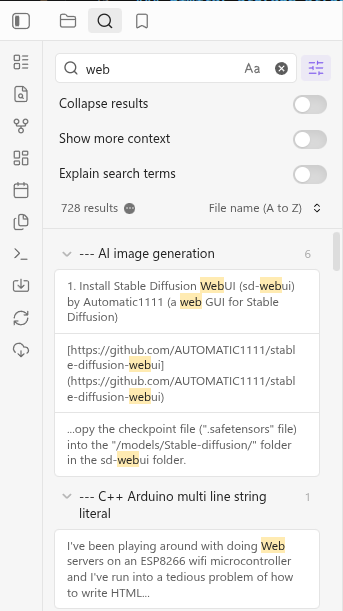](obsidian-search-results.png)

I'm not a fan of seeing every result, I like the option to **Collapse results**.

[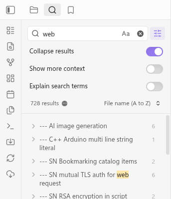](obsidian-search-collapsed.png)

With the **Omnisearch** plugin, the search can do even more, including finding text matches within images and PDF documents.

[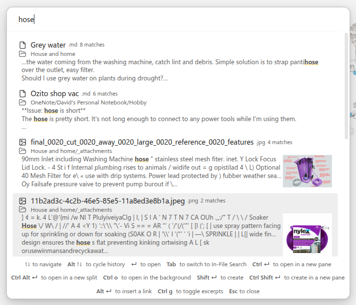](obsidian-omnisearch.png)

### Very available
Obsidian has clients for all sorts of platforms, including:
* Windows
* Mac
* Linux
* Android
* iPhone & iPad

Notes from 1 platform should work just as fine as from any other.

### Everything is files
Everything in an Obsidian **Vault** is a file in folders. 
- Groups - that's a folder.
- Notes - that's a markdown file.
- Images & attachments - those are files.
The config for the vault is stored in 

This is different to how OneNote works, where a section is saved as a `*.onenote` file which contains all notes, attachments, settings, everything.

Here's how my vault looks in Obsidian.

[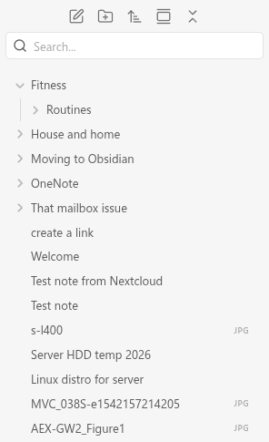](obsidian-as-files.png)

Here's the files in the vault folder.

[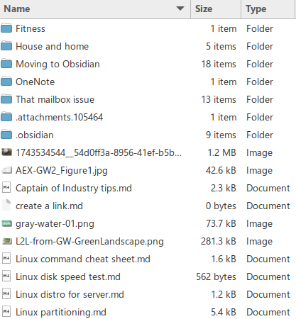](vault-as-files.png)

### It's all markdown
The notes themselves are **markdown** files. Markdown is a popular format for plain-text with simple markings to add rich text. For example:
- Headings start with `#` hash characters, different headings use more. E.g. H3 is `###That heading`
- Lines starting with `-` minus characters turn into bullet points.
- Text wrapped in `*` asterisk characters become italic, two `**` characters become **bold**.

However, you usually don't need to worry about writing in markdown, the editor is similar to OneNote and does a lot of it for you in a pretty GUI.

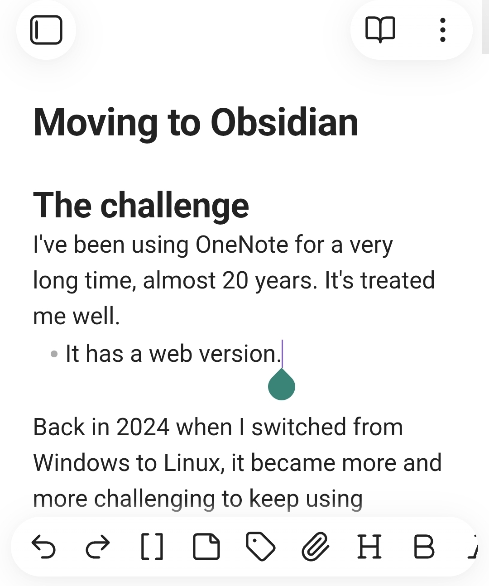

### Plugins are everything
The vanilla out-of-the-box Obsidian does a lot, but a lot of the cooler features are **plugins** created by the community. While you can use Obsidian as it comes, it looks like the vast majority of the Obsidian community use plugins of some sort or another.

It feels like the Skyrim of note taking: there are some purists but not many, mods are everywhere!
- Most use a sync plugin of some description.
- Most recommend **Omnisearch** for better searching.
  https://community.obsidian.md/plugins/omnisearch
- Many talk about using custom navigators for their own favourite flavour of navigating their notes.
- The Importer tool created Obsidian themselves is an optional plugin.
  https://community.obsidian.md/plugins/obsidian-importer

I'm learning to not be afraid to try plugins. There's a **massive** selection to choose from!
https://community.obsidian.md/plugins/

[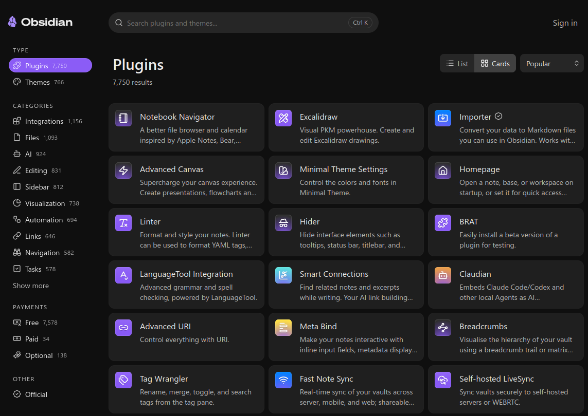](obsidian-plugin-library.png)

## Challenges
It hasn't all been smooth sailing, there are some differences between OneNote and Obsidian that I'm trying to find my way through. I'm hoping that most of these are just different ways of working.

### Importing
It was easy to import my OneNote books into Obsidian using the Obsidian Importer tool, that part was fairly straight-forward and simple. OneNote was difficult to download without having OneNote installed (can't on Linux) so I imported via logging the Importer into OneDrive. A couple of clicks and I was done. 

[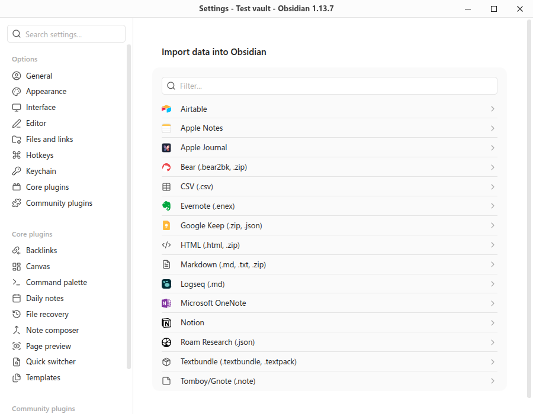](importer-1.png)

[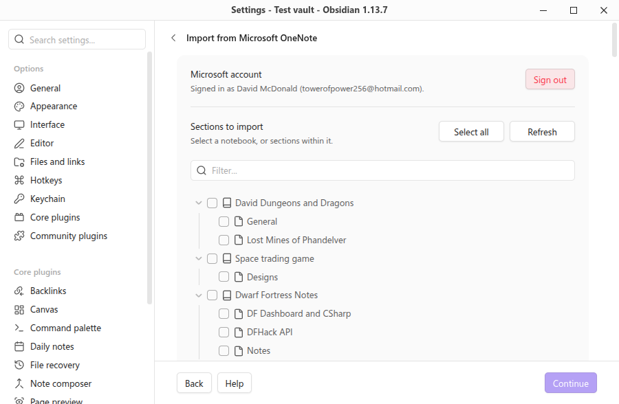](importer-2.png)

Notes, images, attachments, it all came across into a OneNote folder in the Obsidian vault.

However, moving from OneNote to Obsidian, some of the storage structure was changed along the way. It's not a deal-breaker, but it's taking me a little to get comfortable.
- Notes aren't in the same order as they were in OneNote. However, changing the sort order to "Created time (old to new)" fixed that.
- Images & attachments show in the navigator, which is a bit daunting.

I'll take some time to "massage" the content from OneNote into a better Obsidian structure at some point.

### It's a lot to take in 
Obsidian reminds me of Dwarf Fortress in a way: it's a platform for **fun**, but sometimes you have to fight to earn that **fun**. The **fun** might not take time and effort to achieve, but you'll feel satisfaction once you achieve it.

That's not a bad thing, however it can be overwhelming at the start.

Obsidian itself feels like it holds your hand for the basics, but not for the more powerful features.
* The folder structure is free-form. If you structure your notes terribly, it'll let you.
* Some more powerful features are in plugins, not in the base platform. You need to try a few to find which one you like.
* Features like the graph map and tag searching need you to set up links and tags in your notes.

### Attachments
The biggest gripe I'm having is that attachments appear in the navigator, and it gets very messy very quickly. By default, adding an image to a note creates it as a file in the same folder with the same name as the note.

Here's 2 notes: "Photography terms" and "How to align EQ mount", and all of the images attached to those notes stored alongside the note.

[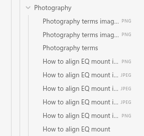](obsidian-attachments-in-folder.png)

There are other options for storing attachments that I should play with, including:
* Vault folder (the top root)
* Same folder as current file
* In subfolder under current folder
* In the folder specified below

[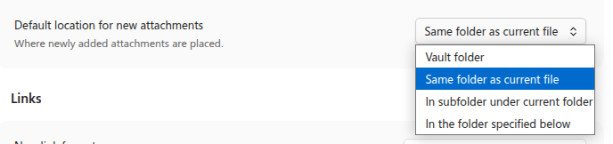](obsidian-attachment-settings.png)

### Syncing 
One of the benefits of having "everything as files" is that syncing your notes for backup or between devices simply means syncing those files.

Out-of-the-box, the only sync solution is Obsidian paid option that syncs with Obsidians file servers. It'll get the job done nice and easy without any fiddling, but let's face it, I want a free method that I control.

[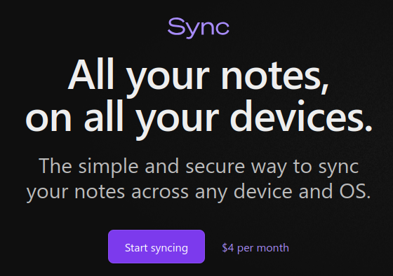](obsidian-sync.png)

Luckily, there's a lot of free plugins out there for syncing an Obsidian vault.

The most popular appears to be **Self-hosted LiveSync**. However, I'm not 100% comfortable with keeping credentials in a plain-text file to use it with Nextcloud.
https://community.obsidian.md/plugins/obsidian-livesync

I host my own **Nextcloud** cloud storage platform at home, so I've been using the plugin **Nextcloud Sync**. It's tailored for Nextcloud, doesn't store credentials in plain-text, and uses Nextcloud features for smarter change checking. 
https://community.obsidian.md/plugins/nextcloud-sync

### Web version
One thing I liked about OneNote is that it had a web-version which was useful for accessing my notes without needing to install OneNote on the machine.

However, Obsidian doesn't have anything like that out-of-the-box. There are some self-hosted web versions of Obsidian made by the community out there that I'll need to explore.
- obsidian-remote https://github.com/sytone/obsidian-remote
- webobsidian https://github.com/xnohat/webobsidian
- Ignis https://github.com/Nystik-gh/ignis
- markport https://github.com/MusiCode1/markport

## Moving forward
I'm going to keep going with Obsidian and move all of my OneNote books into my Obsidian vault. I've been seeking an alternative to OneNote for a while, and now's my chance to do it.
