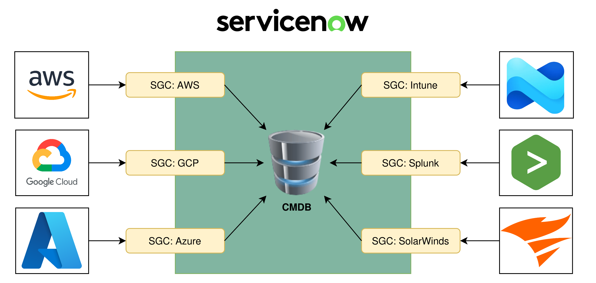
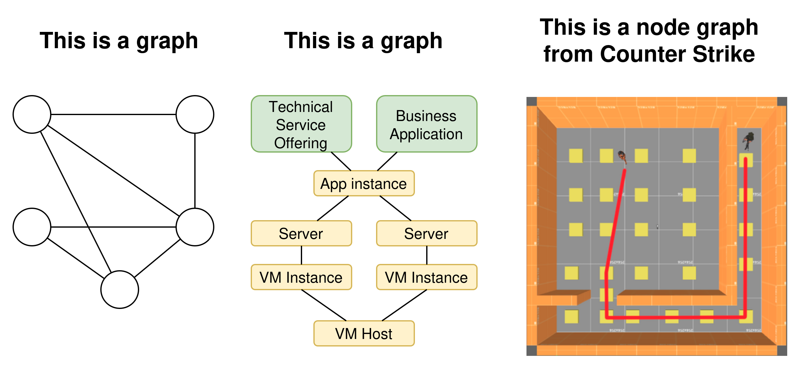
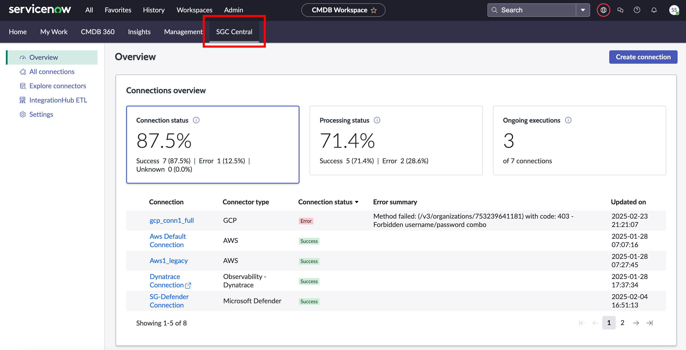
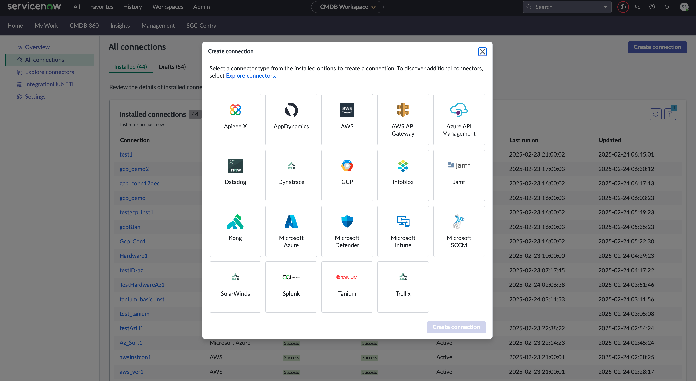

## What is an SGC?
A ServiceNow **SGC (Service Graph Connector)** is a fancy name for an integration that imports data into the ServiceNow CMDB.

[ServiceNow Product - Service Graph Connectors](https://www.servicenow.com/au/products/service-graph-connectors.html)

[SN Docs - Getting started with Service Graph Connectors](https://www.servicenow.com/docs/r/servicenow-platform/configuration-management-database-cmdb/cmdb-sgc-intro.html)

What's the difference between a Service Graph Connector and other data feeds into the CMDB?

| Service Graph Connector                                                             | Regular data-feed integration                                                                 |
| ----------------------------------------------------------------------------------- | --------------------------------------------------------------------------------------------- |
| Certified and supported by ServiceNow the company.                                  | Often custom-created by customers or 3rd party vendors. Not fully supported by ServiceNow. |
| Managed by SGC Central in the CMDB Workspace.                                       | Managed by a dedicated control panel, import sets, or "figure it out yourself".               |
| Typically uses the RTE (Robust Transform Engine).                                   | Could use the RTE, classic Transform Maps, Flows, or be fully scripted.                       |
| Build to work with Multi-Source CMDB, you can see which data came from what source. | Sometimes works with Multi-Source CMDB, but often does not. Especially DIY solutions.         |

## Why "Service Graph"?
In mathematics a **graph** is anything made up of nodes & connections (or vertices & edges). In this context, this is the ServiceNow CMDB with:
* CIs as nodes
* Relationships as connections between the nodes

The word **Service** could relate to services in the CMDB, or it could just be the **Service** in **ServiceNow** to sound cool.

***Service Graph*** Connector
## SGC Central
Within the CMDB Workspace, there's the **SGC Central** workspace for managing your Service Graph Connectors.

[SN Docs - SGC Central](https://www.servicenow.com/docs/r/zurich/servicenow-platform/sgcc-landing.html)

