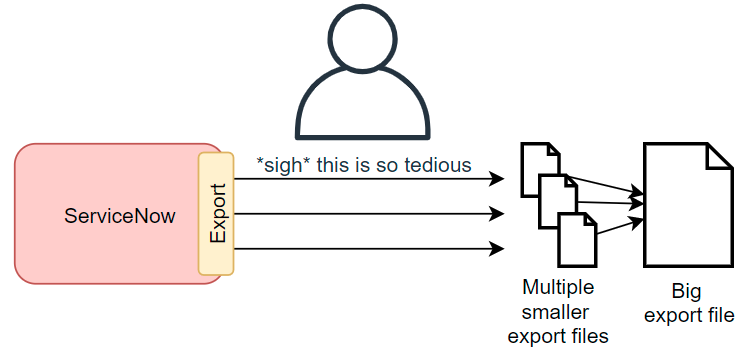
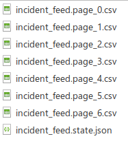
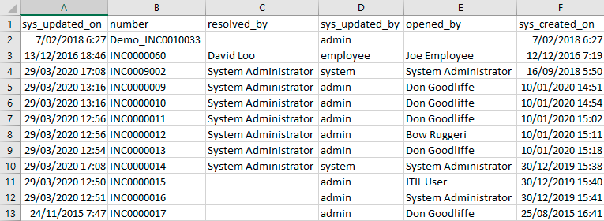
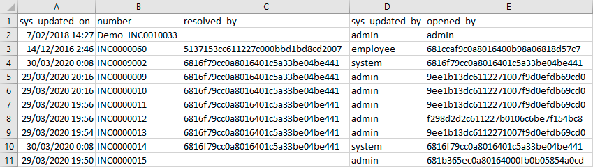

## The challenge
Exporting big sets of data from ServiceNow is a pain. 

By default, exports from ServiceNow are limited to about 1,000 or 10,000 rows. That's OK for most every-day exports, but what if you want to export large amounts of data in the **thousands** or **millions**?

ServiceNow's official answer is to:
* Export the data in chunks, the tedious and hard way
* Combine it yourself

[SN Docs - Break up a large export](https://www.servicenow.com/docs/r/integrate-applications/t_BreakUpALargeExport.html)

When exporting millions of records, this process can take hours!

## Dave's SN Export Tool
A while back, I made an export tool for exporting large amounts of data from ServiceNow.
[Dave's ServiceNow Bulk Export Tool](/posts/2021-07-02-sn-bulk-export/)

However, I've finally spent some time and re-written it to add improvements.

**Dave's SN Export Tool**, bigger and better!

https://github.com/towerofpower256/DavesSnExportTool

* Export unlimited data from ServiceNow from any table your user has access to (default: pages of 1,000 rows).
* Exports data as comma-separated files (CSV).
* Exports using the URL export features, no need for Table API access. Any user can do it!
* Can export display values or system values.
* Authenticate as your browser's session, compatible with SSO authentication.
* Configuration files can be used for regular exports, instead of configuring everything through the command line.
* Resume support, great for resuming an export that was interrupted.
* Delta exports, only exporting data that's changed since the last export.
* Progress animation while exporting data.
* Few dependancies, should run on any computer with Python3 and `requests`.

It works by automating the ServiceNow-recommended process: pulling chunks of data out of ServiceNow by pages.

A big improvement is that it uses URL Exports which anyone can use, instead of the Table API which needs special roles granted to your user.

Adding **cookies** authentication was a big one. My old script could only do basic authentication, and couldn't be used on instances that required SSO. Now, you can use it on any active session with ServiceNow.

I'm also proud of adding in the **progress** animations. Now if it's downloading a big file, you can see that it's still working, instead of thinking "are you frozen? did you die?".

The output file looks just like a CSV export.

Display values:

System values:

## Future improvements
* The **cookies** method of authentication feels a little rough, needing some action by the user. If I wanted a perfect solution, I'd turn this export tool into a browser plugin. But that's not in my skill set right now.
* It doesn't support OAuth. I ahven't had a need to do so yet, so I haven't tried.
* I might want to get it to export attachments in a later version. E.g. export incidents, and any attachments.
* I am not a Python developer, and my Python code is not the cleanest. Please don't judge me too harshly.
